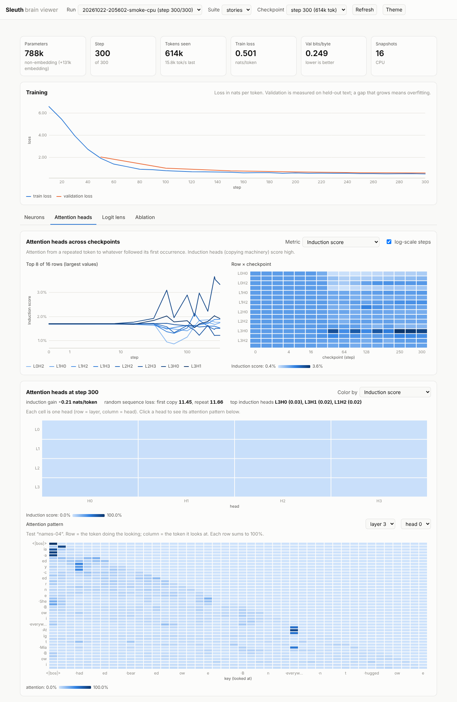

# Sleuth

A fully local lab for building and understanding LLMs:

- **FORGE**: our own tokenizer, model, training loop and inference engine, in plain PyTorch.
- **ANALYZER**: a "brain viewer" for activations, attention, MoE routing, ablations,
  logit lens, and how they all change across training checkpoints.
- **LAB**: equal-compute experiments for making small models faster and act bigger.
- **ASSISTANT** (optional, off by default): explains results via OpenAI, Anthropic,
  llama.cpp or vLLM.

Nothing touches the network unless you turn it on. Design: [PLAN.md](PLAN.md) ·
decisions and results: [LOG.md](LOG.md) · training data and licences: [docs/DATA.md](docs/DATA.md)



## Status

**M1** (tokenizer → 10M model → checkpoints → generation) is done and has run on an
RTX 5060 Ti. **M3** (analyzer core: attention heads, logit lens, ablation) is built and
CPU-tested. **M5** (external models: safetensors + GGUF) is partly built: Llama/Qwen-family
models load; Gemma is next.

| Piece | Where |
|---|---|
| Synthetic corpus generator | `sleuth/forge/data/synthetic.py` |
| Byte-level BPE (train / encode / decode / save) | `sleuth/forge/tokenizer/` |
| Ingest + memory-mapped shards + loader | `sleuth/forge/data/` |
| Transformer (RoPE, RMSNorm, SwiGLU, GQA, QK-norm, tying, taps) | `sleuth/forge/model/` |
| Trainer (bf16, grad accumulation, cosine/WSD, snapshots, exact resume) | `sleuth/forge/train/` |
| Generation (KV cache, temperature/top-k/top-p/min-p, tok/s) | `sleuth/forge/infer/` |
| Our own `.safetensors` reader/writer | `sleuth/formats/safetensors.py` |
| Analyzer: neurons, attention heads, logit lens, ablation, across checkpoints | `sleuth/analyzer/` |
| Local dashboard | `sleuth/ui/` |
| Hardware probe | `scripts/probe_hardware.py` |

## Setup (each machine)

```bash
git clone https://github.com/tbertha35/Sleuth.git && cd Sleuth
git checkout claude/quirky-hamilton-fst7bf       # until it's merged
python3 -m venv .venv && source .venv/bin/activate   # Python 3.11+; 3.12 is the safest bet
```

Install PyTorch for the machine, **then** Sleuth:

| Machine | PyTorch install |
|---|---|
| RTX 5060 Ti / RTX 3060 Ti (x86_64) | `pip install torch` (needs an NVIDIA driver new enough for its CUDA version; if `torch.cuda.is_available()` is False, try `pip install torch --index-url https://download.pytorch.org/whl/cu128`) |
| GX10 / GB10 (aarch64, sm_121) | PyPI has no CUDA build for this. Use `pip install torch --index-url https://download.pytorch.org/whl/cu130`, or NVIDIA's PyTorch container (NGC). Then run the probe: it checks that the build has Blackwell kernels and that each attention kernel actually runs (some have failed on sm_121). |

**Windows (the RTX boxes):** create the venv with `py -3.12 -m venv .venv` and activate it
with `.venv\Scripts\Activate.ps1` (PowerShell). Everything else is the same. Differences
you'll see:
- PyTorch's Windows builds have no FlashAttention kernel, so attention falls back to
  the memory-efficient, cuDNN or plain kernels. That's fine for small models, and the
  probe records which ones work.
- `torch.compile` needs Triton, which isn't bundled on Windows, so keep `compile = false`.
  (A community `triton-windows` package exists; it would be a new dependency, so ask first.)
- No NCCL, so no multi-GPU training on Windows. That only matters on the GX10s (Linux).
- Environment variables in PowerShell: `$env:SLEUTH_DATA = "D:\sleuth\data"`.
- WSL2 (Linux on Windows) would get FlashAttention and Triton. It's optional and can come later.

```bash
pip install -e ".[dev]"        # numpy + pytest, and the `sleuth` command
pytest -q                      # ~80 CPU tests, ~10 s
python scripts/probe_hardware.py --disk-path /path/to/your/nvme   # saves hardware/<host>.json (stays local)
```

The `hardware/*.json` files are git-ignored, so they never leave your machine.
Paste the printed summary to Claude instead; anonymized numbers go into `LOG.md`.

## First run (Milestone 1)

```bash
# The whole pipeline on CPU in ~1 minute: synthetic data -> tokenizer -> shards -> train -> analyze
python -m sleuth demo

# The real M1 model on a GPU (~10M params; minutes on a 5060 Ti or GB10).
# On synthetic data it overfits after ~2000 steps (too little data); see the TinyStories run below.
python -m sleuth info configs/tiny-10m.toml             # params, FLOPs, token budget
python -m sleuth train configs/tiny-10m.toml --set data.shards=data/shards/synthetic
python -m sleuth generate runs/<run-id> --prompt "Once upon a time"
python -m sleuth analyze runs/<run-id>                   # all views, suites/basic
python -m sleuth ui                                      # http://127.0.0.1:8765
```

Then the TinyStories model (download and prepare the data first: see `docs/DATA.md`):

```bash
python -m sleuth train configs/tinystories-10m.toml
python -m sleuth generate runs/<run-id> --prompt "Once upon a time" --samples 3
```

## The analyzer (Milestone 3)

`python -m sleuth analyze runs/<run-id> --suite suites/stories` runs four views on every
checkpoint, and the dashboard shows each as a tab:

| View | Question it answers |
|---|---|
| **Neurons** | How often and how strongly does each MLP neuron fire, and on which kinds of text? |
| **Attention heads** | What does each head look at (the previous token, the first token, …)? Which heads *copy* earlier text (induction heads)? Includes a pattern viewer. |
| **Logit lens** | If the model stopped after layer N, what would it predict? Which layers do the work? |
| **Ablation** | Remove one head or layer: how much worse does the model get, per test category? |

Options: `--views attention,logit_lens` (a subset), `--steps 0,500,6000` (some
checkpoints), `--ablation zero` (instead of mean), `--force` (recompute). Re-running
skips finished checkpoints, so you can analyze while training is still going.

## Other people's models (Milestone 5, in progress)

Sleuth reads `.safetensors` (Hugging Face folders) and GGUF (llama.cpp) files with its
own readers and loads them into its own Transformer, so every analyzer view works on
them too.

| Supported now | |
|---|---|
| Hugging Face folders | Llama, Mistral, Qwen2/2.5, Qwen3 (`config.json` + `*.safetensors` + `tokenizer.json`) |
| GGUF architectures | `llama`, `qwen2`, `qwen3`, with byte-level BPE tokenizers |
| GGUF tensor types | F32, F16, BF16, Q4_0, Q4_1, Q5_0, Q5_1, Q8_0, Q2_K–Q6_K, IQ4_NL, IQ4_XS |
| Coming next | Gemma (needs its own adapter: run `inspect` on your file and share the output), keeping big models quantized in VRAM |

```bash
python -m sleuth inspect path/to/model.gguf          # what's inside: architecture, metadata, tensors
python -m sleuth generate path/to/hf-folder --prompt "The capital of France is"
python -m sleuth analyze path/to/model.gguf --suite suites/stories --views attention,logit_lens
python -m sleuth compare path/to/hf-folder path/to/model-Q8_0.gguf   # same model, two formats: should agree
```

`analyze` on an external model puts the results in `runs/ext-<name>/`, and the
dashboard lists it next to your own runs. Ablation runs the whole suite once per head,
so on big models add `--views neuron_stats,attention,logit_lens` to skip it at first.

Training writes `runs/<run-id>/` with the config, the environment, metrics, weight
snapshots (log-spaced: steps 0, 1, 2, 4, … plus every 500) and resumable checkpoints.
Ctrl-C saves a checkpoint. Continue with `python -m sleuth train --resume runs/<run-id>`.

Things to try:
- `python -m sleuth tokenize --tokenizer data/tokenizers/synthetic-1k.json "any text"`
  shows how text is split into tokens.
- In the dashboard, set the metric to "Category-selective neurons" and watch neurons
  specialize in stories vs. math vs. code as training goes on.
- Generate from early snapshots (`--step 16`, `--step 128`) to see grammar, then
  names, then arithmetic emerge.

Where data and runs live: `data/` and `runs/` in the repo by default. To put them on
another drive, set `SLEUTH_DATA=/mnt/fast/sleuth-data` and `SLEUTH_RUNS=/mnt/fast/sleuth-runs`.

## Tests

```bash
pytest -q          # CPU tests
pytest -m gpu -q   # GPU-only tests (none yet; they arrive with M2)
```
